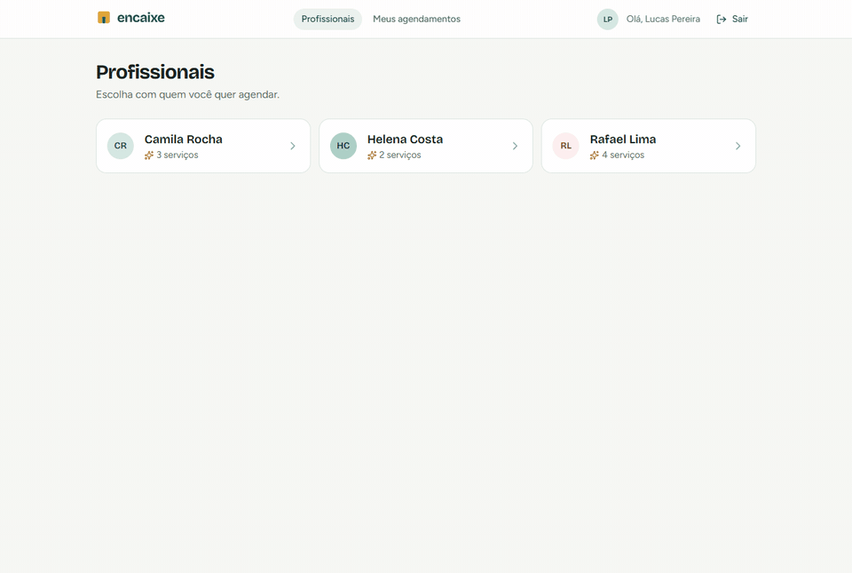
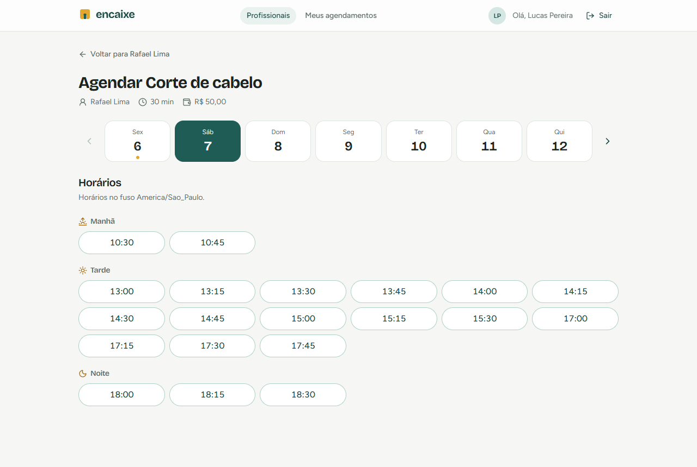
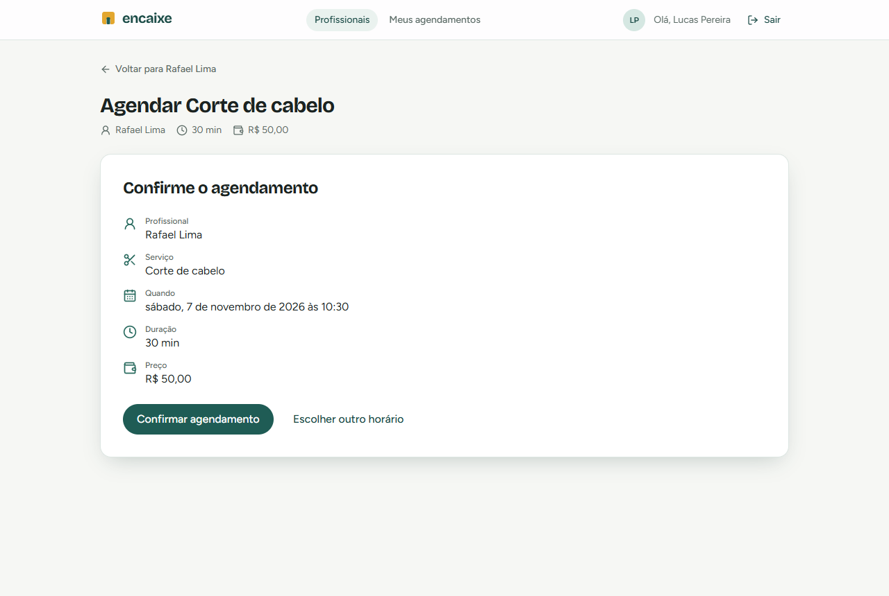
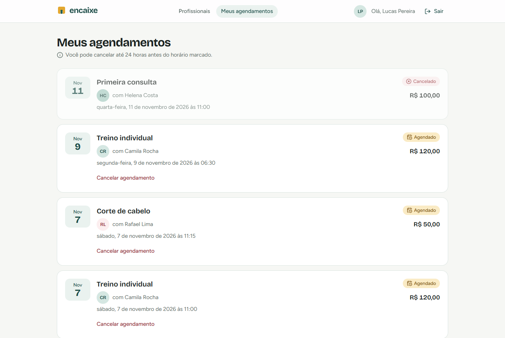
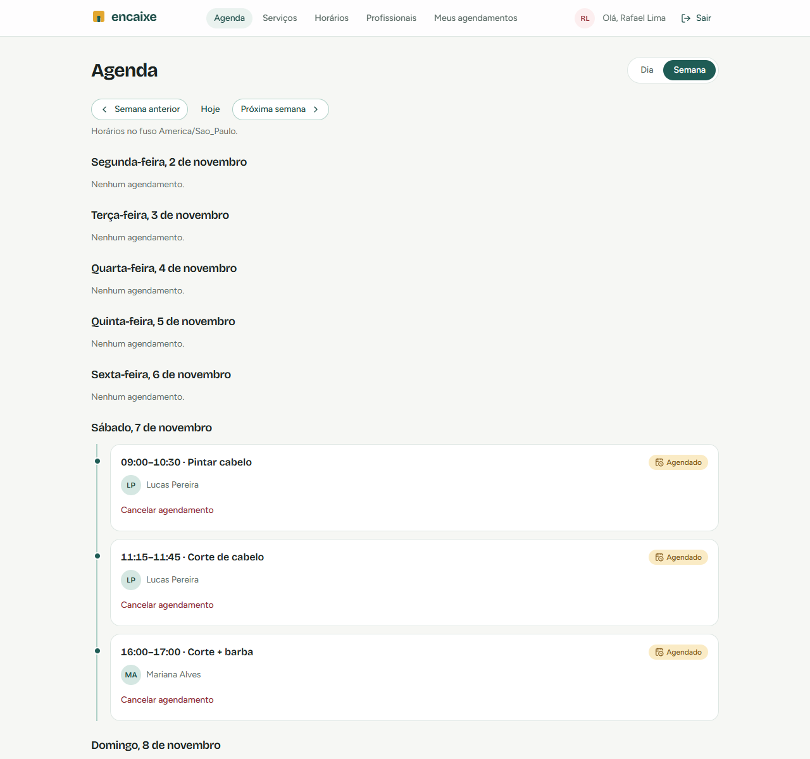
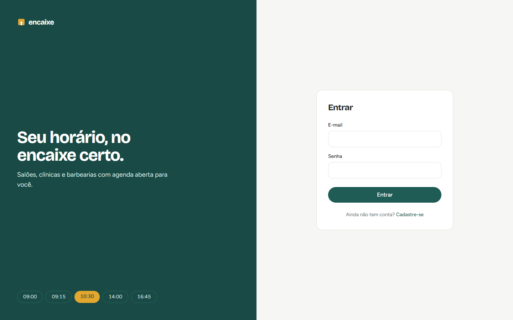
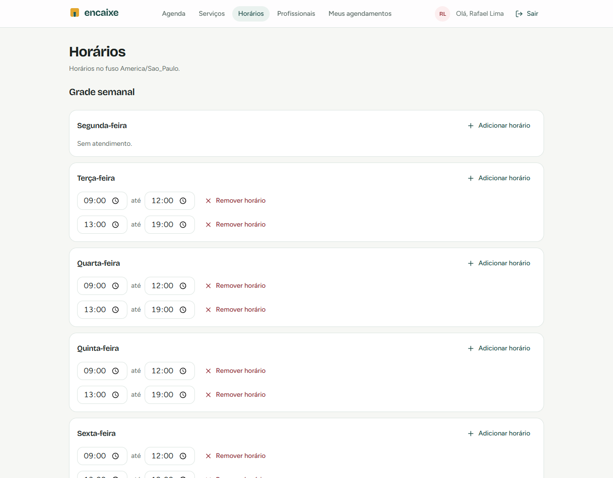
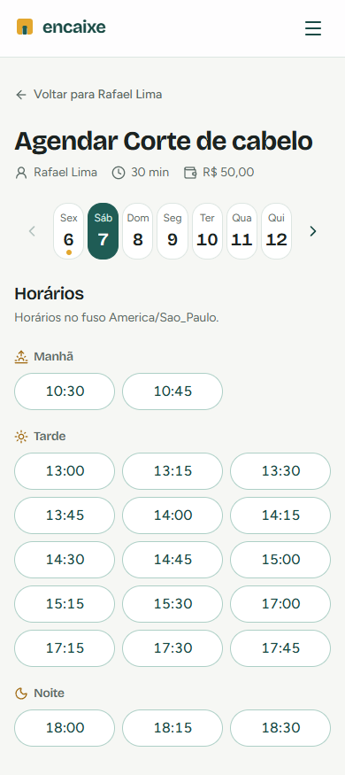
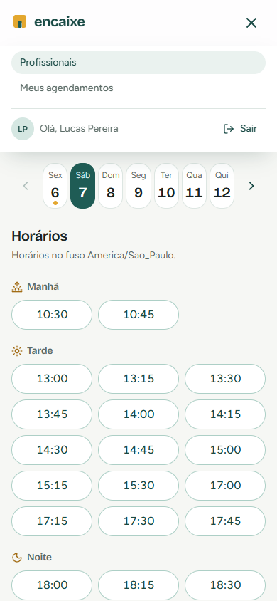
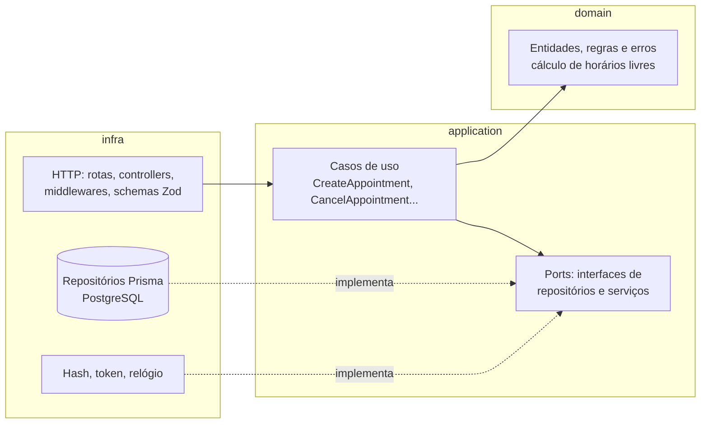

# Encaixe

[](https://github.com/VictormtDev/agendamento-online/actions/workflows/ci.yml)

Plataforma de agendamento online para profissionais autônomos, como salões, barbearias, clínicas e personal trainers. O profissional cadastra serviços e horários de atendimento, e o cliente escolhe um horário livre e agenda em poucos cliques.

**Demo:** https://agendamento-online-50su.onrender.com
**API (Swagger):** https://agendamento-online-50su.onrender.com/docs

| Perfil       | E-mail                    | Senha       |
| ------------ | ------------------------- | ----------- |
| Cliente      | `lucas@demo.agendamento`  | `demo12345` |
| Profissional | `rafael@demo.agendamento` | `demo12345` |

> A demo roda no plano gratuito do Render. A primeira visita depois de um tempo parado pode levar uns 30 segundos para responder.



## O problema

Muitos profissionais ainda agendam pelo WhatsApp: perguntam o horário, conferem a agenda de papel e confirmam à mão. Isso gera horários duplicados, clientes esperando resposta e uma agenda que só o profissional consegue ver.

O Encaixe resolve isso com regras claras:

- O cliente só vê horários **realmente livres**. O cálculo leva em conta a grade semanal, as folgas, os agendamentos existentes e a duração do serviço.
- **Dois clientes nunca ficam com o mesmo horário**, nem quando clicam ao mesmo tempo.
- O agendamento exige **2 horas de antecedência** e pode ser feito até **60 dias** à frente. O cliente pode **cancelar até 24 horas antes**.
- Horários são calculados no **fuso do profissional**, em intervalos de **15 minutos**.

## Telas

| Agendamento                                                         | Confirmação                                                   |
| ------------------------------------------------------------------- | ------------------------------------------------------------- |
|       |  |
| **Meus agendamentos**                                               | **Agenda do profissional**                                    |
|  |    |
| **Login**                                                           | **Grade semanal e folgas**                                    |
|                  |           |

<p align="center">
  
  
</p>

## Arquitetura

Monorepo com npm workspaces: `apps/api` (backend) e `apps/web` (frontend). Em produção, um único serviço Node serve a API e o frontend compilado. O banco fica no Neon.

O backend segue uma **Clean Architecture simplificada**. As regras de negócio não conhecem Express nem Prisma:



- **`domain`**: regras puras, como o cálculo de horários livres e as constantes (`MIN_BOOKING_NOTICE_HOURS`, `MAX_BOOKING_WINDOW_DAYS`...). Não importa nada de fora.
- **`application`**: um caso de uso por arquivo, com um único método `execute`. As dependências chegam pelo construtor, sem framework de injeção.
- **`infra`**: Express, Prisma e bcrypt/JWT. Os erros de domínio viram status HTTP **apenas** no error handler.
- A regra de dependência é **verificada pelo ESLint**: um import que atravesse camadas na direção errada quebra o CI.

O frontend é organizado por funcionalidade (`features/booking`, `features/schedule`...). O estado do servidor fica no TanStack Query, os formulários usam React Hook Form + Zod, e há um design system próprio em `components/ui`.

## Decisões técnicas

**Concorrência em duas camadas.** O caso de uso confere se o horário está livre, para devolver um erro amigável. Mas duas requisições simultâneas podem passar juntas por essa checagem. A garantia final é uma _exclusion constraint_ do PostgreSQL:

```sql
EXCLUDE USING gist ("providerId" WITH =, tstzrange("startsAt", "endsAt", '[)') WITH &&)
WHERE (status = 'SCHEDULED');
```

O repositório traduz a violação em `SlotUnavailableError` (HTTP 409). Um teste de integração dispara várias requisições em paralelo para o mesmo horário e verifica que só uma é aceita.

**Datas e fuso horário.** Tudo é gravado em UTC (`timestamptz`). A grade semanal ("segunda, 09:00–18:00") é interpretada no fuso do profissional com `date-fns` + `@date-fns/tz`, então o horário de verão não desloca nem duplica horários. Nenhuma conta de data é feita com milissegundos espalhados pelo código.

**Relógio injetável.** Regras que dependem de "agora", como a antecedência mínima e o prazo de cancelamento, recebem um port `Clock`. Assim os testes fixam a data e não dependem do dia em que rodam.

**Regra de negócio em um só lugar.** O frontend não repete regras do backend. A janela de 60 dias e o prazo de 24 horas são aplicados pela API, e a interface mostra a recusa dela. Isso evita que front e back divirjam.

**Erros e API consistentes.** Toda resposta de erro segue `{ error: { code, message, details } }`. Listagens têm paginação (`?page=&perPage=`), e todas as rotas estão documentadas em OpenAPI em `/docs`.

**Design system próprio.** Os tokens (cores, fontes, raios) ficam no `@theme` do Tailwind v4. Os componentes (`Button`, `Card`, `StatusBadge`, `Avatar`...) são pequenos e sem biblioteca de UI. A única dependência visual é `lucide-react` para os ícones.

## Stack

| Camada     | Tecnologias                                                          |
| ---------- | -------------------------------------------------------------------- |
| Linguagem  | TypeScript (strict) em todo o projeto                                |
| Backend    | Node.js, Express 5, Zod, JWT + bcrypt                                |
| Banco      | PostgreSQL 16, Prisma (migrations)                                   |
| Frontend   | React, Vite, React Router, TanStack Query, React Hook Form, Tailwind |
| Testes     | Vitest, Supertest, Testing Library                                   |
| Infra e CI | Docker Compose, GitHub Actions, Render + Neon                        |

## Como rodar

Pré-requisitos: Node.js 26 e Docker.

```bash
git clone https://github.com/VictormtDev/agendamento-online.git
cd agendamento-online
cp apps/api/.env.example apps/api/.env   # ajuste o JWT_SECRET
docker compose up -d --wait              # Postgres de dev (:5432) e de teste (:5433)
npm install                              # instala os workspaces e gera o Prisma Client
npx -w apps/api prisma migrate dev       # aplica as migrations
npx -w apps/api prisma db seed           # dados de demonstração (senha demo12345)
npm run dev                              # API e frontend em paralelo
```

O frontend abre no endereço indicado pelo Vite, e a documentação da API fica em `/docs` no servidor da API.

## Testes

```bash
npm run test                          # tudo
npm run test:unit -w apps/api         # regras de domínio e casos de uso (sem banco)
npm run test:integration -w apps/api  # API contra o Postgres de teste, incluindo concorrência
npm run test -w apps/web              # fluxos do frontend com Testing Library
npm run lint && npm run typecheck
```

- **Domínio e casos de uso:** testes unitários com repositórios em memória. São os mais importantes: cada regra de negócio tem o seu.
- **API:** testes de integração com Supertest contra um Postgres real, com as tabelas limpas entre os testes.
- **Frontend:** fluxos críticos, como escolher serviço, dia e horário e confirmar, além do cancelamento e do painel do profissional.

O CI (GitHub Actions) roda formatação, lint, typecheck e todos os testes em cada pull request e em cada push na `main`, com um Postgres de teste como serviço.

## Próximos passos

- Lembrete por e-mail 24 horas antes do horário (fila e job agendado).
- Refresh token, para sessões longas sem login frequente.
- Rate limiting nas rotas de autenticação.
- Status "concluído" e "não compareceu", com histórico do cliente.
